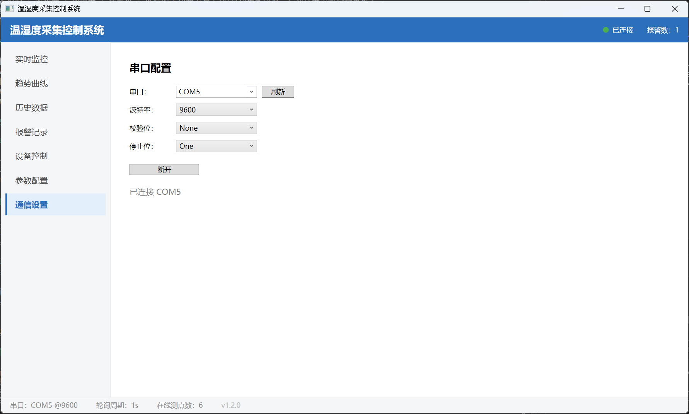
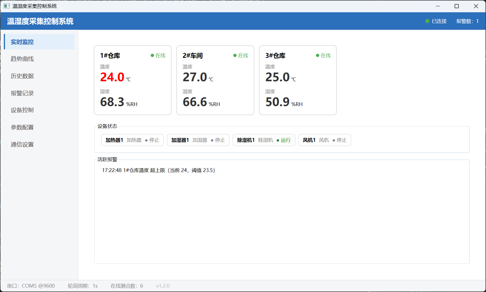
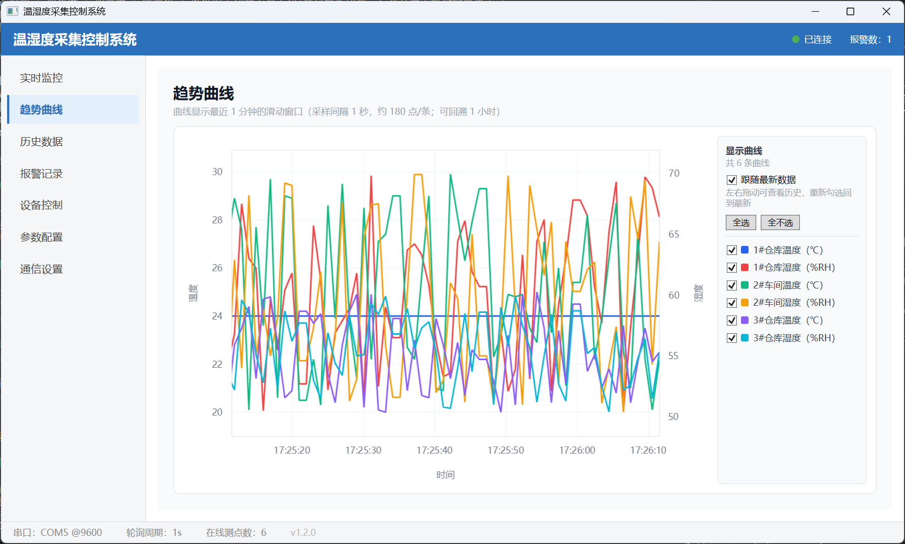
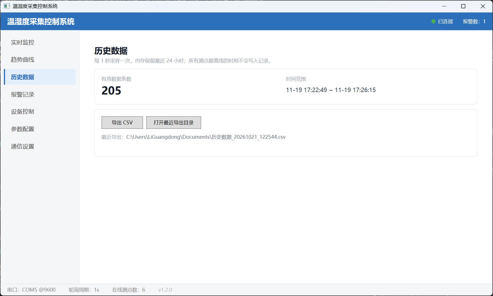
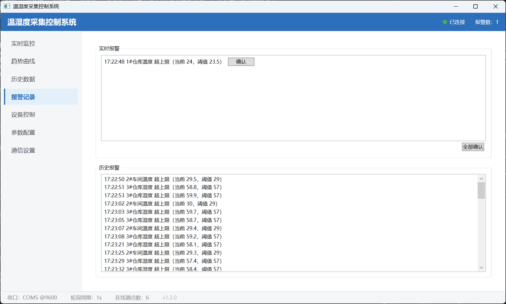
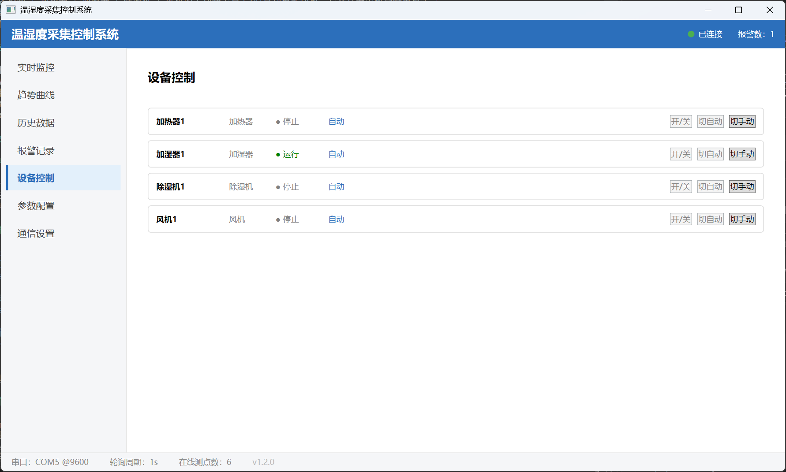
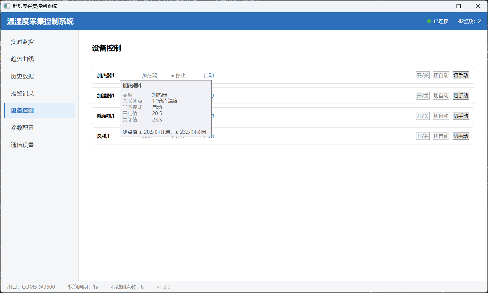
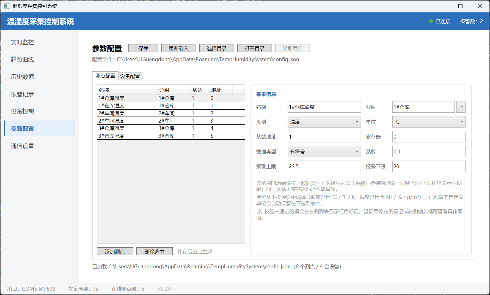

# 温湿度采集控制系统（TempHumiditySystem）

基于 WPF + .NET 8 的温湿度监控系统，通过 **Modbus RTU** 协议经串口采集传感器数据，提供实时监控、越限报警、设备自动/手动控制、历史数据记录与趋势曲线。

## 功能特性

| 模块 | 说明 |
|------|------|
| 实时监控 | 按位置（`GroupName`）分组的温湿度卡片：同组同时具备温度与湿度测点才生成卡片；越限标红，在线状态按数据新鲜度刷新；设备状态标签悬停可查看类型、关联测点、当前模式、开启/关闭值和控制规则 |
| 趋势曲线 | 每个测点一条实时曲线（LiveCharts2），1 秒采样；温度/湿度分列左右 Y 轴，保留最近 1 小时，支持横向缩放 |
| 历史数据 | 1 秒采样，内存保留 24 小时（约 8.6 万条）；所有测点都离线的时刻不记录；显示有效条数与时间范围，支持流式导出 CSV、打开最近导出目录 |
| 报警记录 | 活跃报警 / 历史报警分离，支持单条确认与全部确认；历史报警保留最近 500 条 |
| 设备控制 | 加热器 / 加湿器 / 除湿机 / 风机的手动开关与手动/自动模式切换；写寄存器失败会给出提示 |
| 参数配置 | 测点/设备编辑（左列表 + 右表单），字段级 + 跨行校验，保存前校验、原子写入并保留 `.bak`；关闭程序时提示未保存修改 |
| 通信设置 | 串口选择（支持手动刷新）+ 波特率/校验位/停止位，连接后启动轮询与采样；参数自动记忆，断线自动重连 |

## 界面截图

> 以下截图均为在本机实际运行 v1.2.0 时抓取：串口 `COM5`（com0com 虚拟串口对）连接 Modbus 从站模拟器（从站地址 1，`0x0000~0x0005` 共 6 个寄存器），配置为 3 组温湿度测点 + 4 台设备。图中数值由模拟器实时生成，仅用于展示界面行为。图片存放于 [`docs/screenshots/`](./docs/screenshots)。

### 通信设置



- **参数区**：串口下拉可直接输入，也可点「刷新」重新枚举（插拔 USB 转串口后无需重启程序）；波特率 / 校验位 / 停止位从固定列表中选择。
- **连接状态**：点击「连接」后按钮变为「断开」，下方状态行显示 `已连接 COM5`；断开过程中显示「断开中…」并出现进度条，避免界面看起来无响应。连接成功后参数写入 `settings.json`，下次启动自动恢复。
- **全局状态**：顶栏绿灯表示链路已连接，右侧汇总活跃报警数；底栏显示当前串口参数、轮询周期与在线测点数。

### 实时监控



- **测点卡片**：按 `GroupName` 分组，一组一张卡片，卡内固定展示「温度 + 湿度」两路读数；越限的数值标红（图中 `1#仓库` 温度 24.0 ℃ 已超过上限 23.5 ℃）。
- **在线状态**：卡片右上角绿点 + “在线”；测点超过数据新鲜度阈值（默认 3 秒）未更新时变红点，读数置灰显示 `--`，不展示过期数值。
- **设备状态**：一行列出全部设备的运行/停止（绿点 = 运行，灰点 = 停止），鼠标悬停可查看设备参数与自动控制规则（见「设备参数提示」一图）。
- **活跃报警**：底部实时列出尚未恢复的报警，格式为「时间 测点 报警类型（当前值，阈值）」，与顶栏报警数同源。

### 趋势曲线



- **双 Y 轴**：每个测点一条曲线，1 秒采样；温度走左轴、湿度走右轴，两套刻度互不干扰（图中左侧 20~30 ℃、右侧 50~70 %RH）。
- **滑动窗口**：绘图区固定显示最近 1 分钟的窗口（约 180 点/条），曲线密度恒定，不会越跑越糊；数据在后台继续累积，取消勾选「跟随最新数据」后可左右拖动回看。
- **曲线开关**：右侧「显示曲线」可逐条勾选，取消勾选只是不再绘制，采样不会中断，重新勾选立即补齐整个窗口；「全选 / 全不选」用于批量操作。

### 历史数据



- **统计卡片**：显示有效数据条数与覆盖的时间范围；1 秒采样、内存保留最近 24 小时（约 8.6 万条），所有测点都离线的时刻不会写入记录。
- **导出**：「导出 CSV」流式写出，UTF-8 BOM 编码（Excel 打开中文不乱码），离线测点对应单元格留空；「打开最近导出目录」直接在资源管理器中定位上次导出的文件。
- **路径记忆**：最近一次导出路径保存在 `settings.json`，重启后仍显示在页面底部。

### 报警记录



- **上下分区**：上半区为实时报警（仍处于越限状态），下半区为历史报警（已恢复正常），报警恢复后自动从实时区移入历史区。
- **确认操作**：每条报警可单独「确认」，也可点「全部确认」；历史报警保留最近 500 条，超出后丢弃最早的记录。
- **记录文案**：统一为「时间 测点 报警类型（当前值，阈值）」。测点数值在阈值附近抖动时会反复触发/恢复，因此同一测点可能出现多条历史记录（图中 `3#仓库湿度` 即属于这种情况）。

### 设备控制



- **逐行展示**：每行一台设备，包含名称、类型、当前运行状态（`● 运行` 绿 / `● 停止` 灰）与当前模式（自动 = 蓝、手动 = 橙）。
- **操作按钮**：「开/关」仅在手动模式下可用，「切自动」「切手动」按当前模式互斥禁用，避免误操作；自动模式下设备由关联测点读数与开启/关闭阈值（迟滞区间）驱动。
- **写入反馈**：手动开关会写设备寄存器（功能码 06），写失败时页面上会给出提示，不会静默失败。

### 设备参数提示



- 鼠标悬停设备行（监控页「设备状态」标签同样支持）弹出提示：类型、关联测点、当前模式、开启值、关闭值，以及一句话形式的控制规则。
- 图中 `加热器1` 的规则是「测点值 ≤ 20.5 时开启，≥ 23.5 时关闭」，即升温类设备：低于开启值启动，升到关闭值停机，两个阈值之间构成迟滞区间。

### 参数配置



- **工具栏**：保存 / 重新载入 / 选择目录 / 打开目录 / 立即重启，下方显示当前生效的配置文件路径。
- **左侧列表**：测点与设备两个页签，列出名称、分组、从站地址等关键字段；校验不通过的行显示红色标记，鼠标悬停标记或右侧输入框可查看具体原因。
- **右侧表单**：选中项的完整参数编辑区，字段级校验（必填、范围、数据类型）与跨行校验（重名、寄存器地址冲突、上下限与迟滞区间关系）在保存前统一执行，任一不通过都不会写盘。
- **保存安全**：先写 `config.json.tmp`，再原子替换并保留 `.bak`；配置保存后需重启生效，可用工具栏「立即重启」一步完成。

## 技术栈

- **框架**：WPF，`.NET 8`（`net8.0-windows`）
- **MVVM**：`CommunityToolkit.Mvvm` 8.4.2（`[ObservableProperty]` / `[RelayCommand]` / `ObservableValidator`）
- **图表**：`LiveChartsCore.SkiaSharpView.WPF` 2.0.0-rc5.4
- **串口**：`System.IO.Ports` 10.0.11
- **串口枚举**：`System.Management` 8.0.0（WMI）

## 快速开始

### 环境要求

- Windows 10/11
- .NET 8 SDK
- 可用的串口设备（调试时可使用 com0com 等虚拟串口对）

### 构建与运行

```powershell
# 还原依赖
dotnet restore

# 编译
dotnet build TempHumiditySystem.sln

# 运行
dotnet run --project TempHumiditySystem/TempHumiditySystem.csproj
```

也可以用 Visual Studio 2022 打开 `TempHumiditySystem.sln` 后直接 F5。

### 使用流程

1. 首次启动会生成示例配置（默认目录 `%APPDATA%\TempHumiditySystem\config.json`）：1 组温湿度测点与 4 台设备（加热器 / 加湿器 / 除湿机 / 风机）。示例数据在 `SystemConfig.CreateSample()` 中维护。
2. 进入「通信设置」页，选择串口与波特率，点击「连接」。配置成功后连接参数会写入 `settings.json`，下次启动自动恢复。
3. 连接成功后轮询线程开始采集（1 秒/轮），历史采样线程同步每秒记录一次。
4. 在「参数配置」页修改测点/设备，保存后点击「立即重启」或手动重启程序生效。

## 项目结构

```
TempHumiditySystem/
├── .editorconfig                       # 编码与代码风格约定
├── .github/workflows/
│   ├── build.yml                       # push / PR 编译检查
│   └── release.yml                     # v* 标签发布单文件 exe
├── ARCHITECTURE.md
├── README.md
├── TempHumiditySystem.sln
├── docs/screenshots/                   # README 界面截图
└── TempHumiditySystem/
    ├── App.xaml / App.xaml.cs          # 入口 + 组合根（引擎装配、事件接线、全局异常兜底）
    ├── MainWindow.xaml / .cs           # 主窗口（顶栏 + 左导航 + 内容区 + 底栏）
    ├── TempHumiditySystem.csproj
    ├── Models/
    │   ├── AppSettings.cs              # 应用级设置（配置目录、通信参数、最近导出路径）
    │   └── ModBus/
    │       ├── SensorPoint.cs          # 测点（静态配置 + 运行时状态）
    │       ├── Device.cs               # 控制设备
    │       ├── Alarm.cs                # 报警记录
    │       ├── SystemConfig.cs         # 系统配置（JSON 读写、原子保存）
    │       └── ModbusDataTypeConverter.cs # 旧配置数据类型兼容
    ├── Services/
    │   ├── Interface/                  # IPollingService / ISerialPortService
    │   ├── MeException/                # ModbusException / SerialPortFailureException
    │   ├── SerialAssistant/            # 串口层
    │   │   ├── SerialPortService.cs    # 后台读线程 + 同步写 + 故障上报
    │   │   ├── SerialSetting.cs
    │   │   ├── SerialPortUtil.cs       # 串口枚举（WMI，失败回退 GetPortNames）
    │   │   ├── SerialPortInfo.cs
    │   │   ├── HexUtil.cs              # ASCII/HEX 转换工具（预留）
    │   │   └── LogWriter.cs            # 文件日志
    │   └── Modbus/                     # 协议层 + 业务引擎
    │       ├── ModbusRTUClient.cs      # 收发事务、CRC、超时、广播写
    │       ├── ModbusFrame.cs          # 帧构造与解析
    │       ├── Crc16.cs                # CRC16 查表法
    │       ├── ModbusTiming.cs         # 波特率相关时序
    │       ├── PollItem.cs
    │       ├── PollingService.cs       # 轮询调度 + 自动重连
    │       ├── SensorCollectService.cs # 采集适配器（批量读）
    │       ├── AlarmEngine.cs
    │       ├── ControlEngine.cs
    │       ├── HistoryStore.cs         # 历史环形缓冲（线程安全）
    │       ├── HistorySample.cs
    │       └── HistorySampler.cs       # 每秒采样
    ├── Converters/UiConverters.cs      # 枚举中文、上下限空值、未选中禁用
    ├── Resources/DeviceToolTips.xaml   # 设备控制参数提示模板（两个页面共用）
    ├── ViewModels/
    │   ├── Editing/                    # 配置编辑模型（ObservableValidator 校验）
    │   │   ├── EditModelBase.cs
    │   │   ├── SensorEditModel.cs
    │   │   └── DeviceEditModel.cs
    │   ├── MainWindowViewModel.cs      # 导航 + 顶/底栏汇总
    │   ├── MonitorViewModel.cs
    │   ├── TrendViewModel.cs
    │   ├── HistoryViewModel.cs
    │   ├── AlarmViewModel.cs
    │   ├── ControlViewModel.cs
    │   ├── ConfigViewModel.cs
    │   ├── CommViewModel.cs
    │   └── NavItem.cs
    └── Views/                          # 7 个页面 XAML
```

## 配置说明

配置文件路径由 `SystemConfig.ResolvePath()` 统一解析：优先使用参数配置页选定的目录，未选择时回退 `%APPDATA%\TempHumiditySystem\config.json`。文件使用带 BOM 的 UTF-8，中文明文落盘，字段名大小写不敏感。

**保存安全**：保存时先写 `config.json.tmp`，再通过 `File.Replace` 原子替换，原文件保留为 `config.json.bak`；解析失败时先把损坏文件改名为 `config.json.corrupt-yyyyMMdd_HHmmss`，再生成示例配置。

### 测点（SensorPoint）

| 字段 | 说明 |
|------|------|
| `Name` | 测点名（同一配置内唯一） |
| `SlaveId` | Modbus 从站地址（1~247） |
| `RegisterAddress` | 保持寄存器地址（0~65535） |
| `DataType` | 数据类型：`UInt16`（无符号 16 位）/ `Int16`（有符号 16 位），每个测点占 1 个寄存器 |
| `Scale` | 缩放系数（原始值 × Scale = 物理值） |
| `Unit` | 单位（如 ℃、%RH） |
| `Category` | 类别：`Temperature` / `Humidity` |
| `HighLimit` / `LowLimit` | 报警上/下限（留空表示不设限） |
| `GroupName` | 分组名（同一位置的温度 + 湿度归为一组） |

### 设备（Device）

| 字段 | 说明 |
|------|------|
| `Name` / `Type` | 设备名 / 类型（Heater / Humidifier / Dehumidifier / Fan） |
| `SlaveId` / `WriteAddress` | 从站地址 / 写寄存器地址（功能码 06：0 = 停止，1 = 运行） |
| `LinkedSensorName` | 关联测点名（必须存在于测点列表） |
| `OnAt` / `OffAt` | 开启 / 关闭阈值，两者构成迟滞区间 |
| `TurnsOnBelow` | 开启方向：`true` = 低于开启值启动（升温类）；`false` = 高于开启值启动（降温类） |

**自动控制规则**

- 升温类（`TurnsOnBelow = true`）：测点值 ≤ `OnAt` 开启，运行到 ≥ `OffAt` 关闭；需满足 `OnAt < OffAt`。
- 降温类（`TurnsOnBelow = false`）：测点值 ≥ `OnAt` 开启，运行到 ≤ `OffAt` 关闭；需满足 `OnAt > OffAt`。

### 运行时状态

`SensorPoint.CurrentValue` / `IsOnline` / `IsAlarming` / `LastUpdateTick`、`Device.Mode` / `IsRunning` 等运行时字段均标记 `[JsonIgnore]`，不会写入配置文件。

在线判定：`SensorPoint.IsFresh()` 以「最近一次成功读取的 `LastUpdateTick` 未超过 `StaleMs`（默认 3000ms，约 3 倍轮询周期）」为准；监控卡片与底栏“在线测点数”统一使用该口径。

## 数据、日志与发布

- **采样与保留**：轮询与历史采样均为 1 秒一次；历史数据在内存中保留最近 24 小时（`MaxSamples = 86400`）。所有测点都无效的时刻不会写入历史。
- **CSV 导出**：流式写出，UTF-8 BOM（Excel 中文不乱码）；离线测点对应单元格为空。导出路径记录在 `settings.json`，可在历史页一键打开最近导出目录。
- **日志**：位于 exe 同目录 `logs\yyyyMMdd.log`，记录程序启动/退出、串口故障、链路断开/恢复、控制写失败与未处理异常；错误日志立即刷盘。
- **应用设置**：`settings.json` 保存在 exe 同目录（绿色部署）；目录不可写时降级到 `%APPDATA%\TempHumiditySystem\settings.json`。
- **发布**：推送 `v*` 标签触发 `.github/workflows/release.yml`，产出 win-x64 自包含单文件 `TempHumiditySystem-<tag>-win-x64.exe`；push / PR 由 `build.yml` 执行编译检查。

## 相关文档

- [项目架构文档](./ARCHITECTURE.md)
